# SmartCattle Frontend

Web interface for **SmartCattle**, a platform that monitors cattle farms with cameras and computer vision. Farm owners and workers use it to see what is happening on the farm, receive alerts when an animal leaves its safe zone or a person appears where they should not, and review what happened afterwards.

This repository contains only the frontend. The REST API lives in the separate `SmartCattle-Backend` repository (Python, FastAPI), and detection (OpenCV + YOLO) belongs to `SmartCattle-AI`.

> **Status:** Phases 1–9 are complete, plus a realistic 3D pasture, analytics, a daily report, a first-run conversation and the **Cartel de feria** redesign: a public scroll story, flat poster inks and an assistant named Lucero. Cameras are live only: video upload is gone. See [Roadmap](#roadmap).

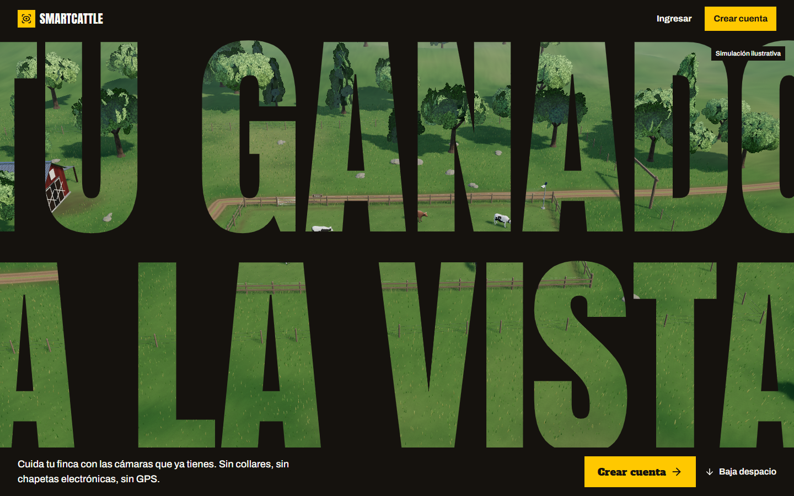

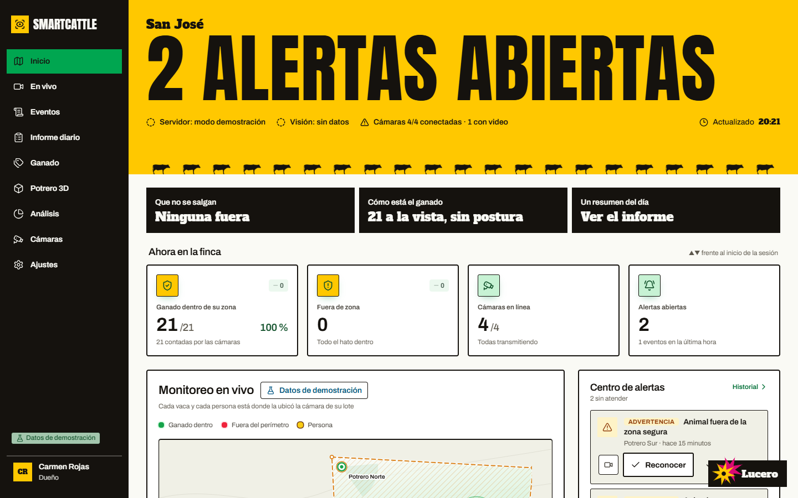

| Login (desktop) | Login (mobile) |
|---|---|
| 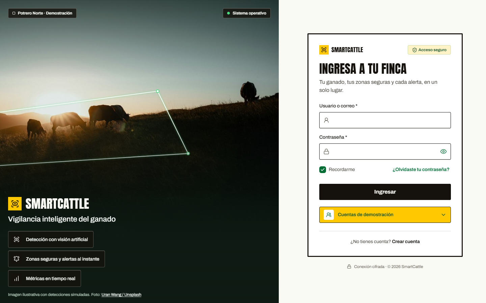 | 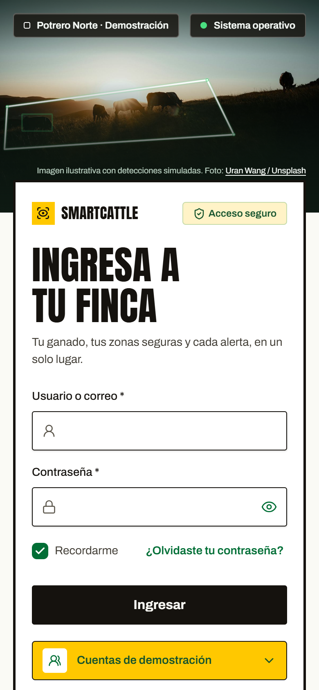 |

| Home on a phone | Mobile "Más" sheet |
|---|---|
| 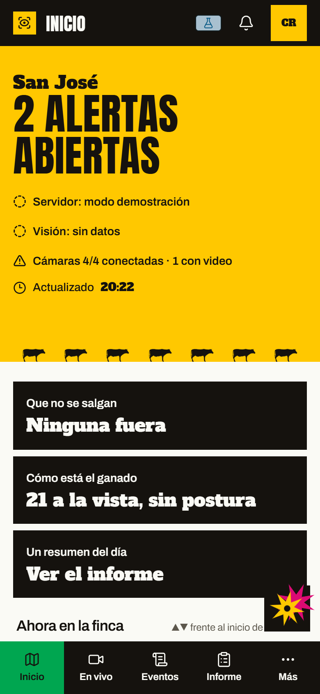 | 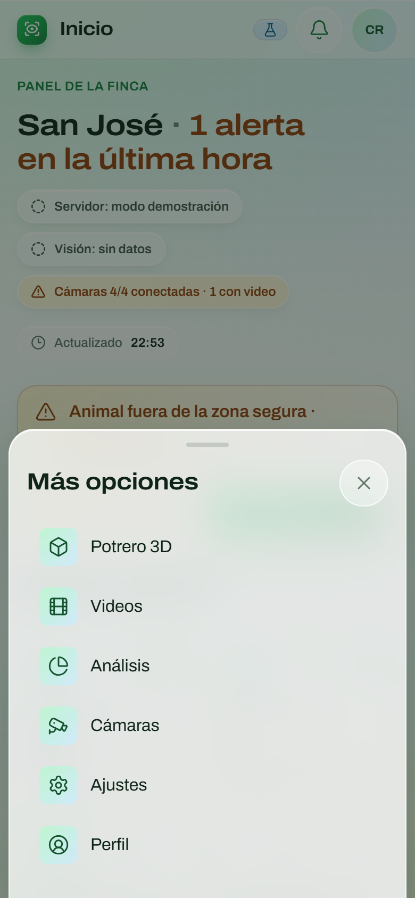 |

---

## Contents

- [Technology stack](#technology-stack)
- [Getting started](#getting-started)
- [Environment variables](#environment-variables)
- [Architecture](#architecture)
- [Backend connection](#backend-connection)
- [Data sources and mock data](#data-sources-and-mock-data)
- [Authentication](#authentication)
- [Routing and navigation](#routing-and-navigation)
- [Dashboard](#dashboard)
- [Live monitoring](#live-monitoring)
- [3D pasture](#3d-pasture)
- [Daily report](#daily-report)
- [First run and the assistant](#first-run-and-the-assistant)
- [Analytics](#analytics)
- [Motion](#motion)
- [Design system](#design-system)
- [Accessibility](#accessibility)
- [Testing and quality checks](#testing-and-quality-checks)
- [Implemented features](#implemented-features)
- [Roadmap](#roadmap)
- [Credits](#credits)

---

## Technology stack

| Area | Choice | Why |
|---|---|---|
| UI | React 19 | Component model, large ecosystem |
| Language | TypeScript 6 (strict) | Typed API contracts and safer refactors |
| Build tool | Vite 8 | Fast dev server, CSS Modules out of the box |
| Routing | React Router 8 | Data router with nested layout routes |
| Styling | Plain CSS: CSS Modules + custom properties | No framework lock-in, tokens in one file, one ink per page |
| Icons | lucide-react | Consistent stroke icons, tree-shaken |
| 3D | three.js + @react-three/fiber + @react-three/drei | Declarative 3D scene in React, orbit controls, HTML labels, glTF loading |
| Motion | motion (`motion/react`, the successor of framer-motion) | Page transitions, layout animations, shared-element indicators, springs, reduced-motion hook |
| Charts | Recharts | Composable SVG charts that read colors from CSS tokens |
| Font | Archivo Variable (self-hosted via Fontsource) | One family with a width axis for hierarchy |
| Tests | Vitest | Same config as Vite, fast |
| Lint | ESLint 10 + typescript-eslint | Flat config |

No UI kit, CSS framework or state library is used. The public page, the 3D pasture and the analytics page are lazy-loaded, so three.js and Recharts are only downloaded when those pages open.

## Getting started

Requirements: Node.js 22.22+ (required by React Router 8; declared in `engines`) and npm. Tested with Node 26.8.1.

```sh
npm install
cp .env.example .env   # PowerShell: Copy-Item .env.example .env
npm run dev            # http://localhost:5173
```

| Command | What it does |
|---|---|
| `npm run dev` | Start the Vite dev server with hot reload |
| `npm run build` | Type-check (`tsc -b`) and build to `dist/` |
| `npm run preview` | Serve the production build locally |
| `npm run lint` | Run ESLint |
| `npm test` | Run the Vitest suite once |

In development, a component gallery is available at `/dev/ui`. It is excluded from production builds.

## Environment variables

Copy `.env.example` to `.env`. Never commit `.env`.

| Variable | Default | Purpose |
|---|---|---|
| `VITE_API_BASE_URL` | `http://localhost:8000` | Base URL of the SmartCattle FastAPI backend. Trailing slashes are removed. |
| `VITE_DATA_SOURCE` | `mock` (`.env.example` uses `hybrid`) | `api`, `mock` or `hybrid`. See [Data sources](#data-sources-and-mock-data). A missing or invalid value falls back to `mock`, which never contacts the backend. |

The frontend holds no secrets. Do not put API keys in `VITE_*` variables: they are embedded in the client bundle. `AI_API_KEY` belongs only to the backend and the AI service.

For production, change only `VITE_API_BASE_URL` (for example `https://your-backend-domain.example`) and add the frontend origin to the backend's `ALLOWED_ORIGINS`. Vite reads these values at build time, so rebuild after changing them.

---

## Architecture

### System context

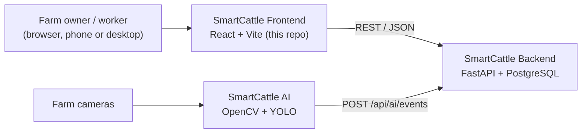

The frontend reads from the backend and only writes video analysis summaries. It never calls the AI service directly and never posts AI events.

### Frontend layers

UI components never call `fetch`. Every request goes through one HTTP client and a typed service layer, and every screen receives data together with its origin (`api`, `mock` or `unavailable`).

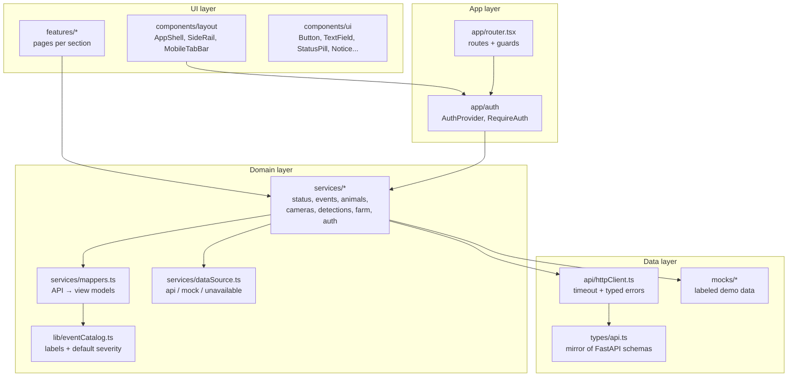

### Folder structure

```text
src/
  api/          HTTP client (every method), configuration, typed errors,
                response validation, and the stored session's access token
  app/          App root, router, navigation config, auth context and guards
  assets/       Images (login photo, with embedded provenance)
  components/
    layout/     AppShell, SideRail, TopBar, MobileTabBar, MoreSheet, AlarmBanner
    ui/         Reusable UI primitives (GlassCard, BrandMark, Button, TextField, StatusPill, ...)
  features/     One folder per section (auth, dashboard, monitoring, events, landing, onboarding, report, assistant, pasture3d, ...)
  lib/          Pure helpers: event catalog, permissions, safe storage, zone alarm
                (`permissions.ts` mirrors the roles the backend enforces; it
                shapes the interface and protects nothing)
  motion/       Motion presets and primitives: FadeUp, Reveal, StaggerItem, CountUp,
                AnimatedNumber, DeltaChip, PulseRing, MaskedText
  mocks/        The only place with fictional data (clearly labeled)
  services/     Data access per capability, mappers, source resolution
  styles/       Design tokens, base styles, reduced-motion rules
  types/        API contract mirror, domain view models, auth types
public/
  models/       glTF models for the 3D pasture (cow.glb) and their credits
docs/
  screenshots/  Images used in this README
```

Tests live next to the code they cover (`*.test.ts`). They run in Node and
render components with `renderToStaticMarkup`, so they cover what a component
produces rather than how it behaves under interaction -- which is why the
assertions are about the text and structure a user would be given, not about
clicks.

---

## Backend connection

The backend (`SmartCattle-Backend`) is a FastAPI service backed by PostgreSQL (SQLAlchemy + Alembic). These are the endpoints that exist today:

| Method | Path | Response | Used for |
|---|---|---|---|
| GET | `/health` | `{ "status": "ok" }` | Backend online/offline indicator |
| GET | `/api/status` | `version`, `ai_service.configured`, `storage`, `auth_enabled` | System status. `configured` means an AI URL is set, **not** that the AI is online. `auth_enabled` false means sign-in is switched off on that deployment. |
| POST | `/api/auth/register`, `/api/auth/login` | token + user | Sign-up and sign-in |
| GET | `/api/auth/me` | The signed-in user | Confirming a stored token |
| GET | `/api/animals` | `{ items, total }` | The registered herd, and its count |
| POST, PATCH | `/api/animals`, `/api/animals/{tag}` | One animal | Registering and editing (**owner**) |
| POST | `/api/animals/{tag}/deactivate` | One animal | Withdrawing an animal (**owner**). There is no DELETE. |
| GET | `/api/events` | Newest first; filters `camera_id`, `level`, `event_type`, and `limit`/`offset` | Alerts and history |
| GET | `/api/cameras`, `/api/cameras/{id}` | `{ items, total }` / one camera | Camera list and status |
| GET | `/api/zones` | `{ items, total }` | Safe zones (**signed in**) |
| POST, PATCH, DELETE | `/api/zones/...` | One zone | Editing a safe zone (**owner**) |
| POST | `/api/videos/analyses` | Saved analysis | Stores a finished analysis (**signed in**) |
| GET | `/api/videos/analyses`, `/api/videos/analyses/{id}` | Analyses list / one analysis | Analysis history |
| GET | `/api/metrics/summary` | Aggregated counts | Metrics summary |
| POST | `/api/ai/events`, PUT `/api/ai/cameras/{id}/status`, PUT `/api/animals/{tag}/detection` | — | AI service only (API key). **The frontend never calls them.** |

`POST /api/videos/analyses` needs a signed-in user rather than the AI key,
because it is called by the browser and `AI_API_KEY` cannot live in a `VITE_`
variable -- those are public in the bundle. That is also why it was the one
unauthenticated path into the shared events table until users existed.

Event shape (mirrored in `src/types/api.ts`):

```json
{
  "id": "uuid",
  "event_type": "cattle_out_of_zone",
  "camera_id": "camera-01",
  "detected_object": "cow",
  "confidence": 0.95,
  "timestamp": "2026-10-03T15:30:00Z",
  "received_at": "2026-10-03T15:30:01Z",
  "level": "high"
}
```

`level` is the backend's severity, derived from the confidence (0.9 and above
is `high`, below 0.6 is `low`). The frontend maps it to its own vocabulary and
records `severitySource: 'backend'`; the per-type default in `eventCatalog`
remains the fallback for a backend that predates the field.

`timestamp` is the AI service's clock and `received_at` is the backend's. The
events list is sorted by `timestamp`, because that is when the thing happened,
while the backend returns them ordered by `received_at` -- the only clock it
controls.

The backend's CORS policy allows `GET`, `POST` and `PUT`, the headers
`Content-Type`, `X-API-Key`, `Authorization` and `X-Request-ID`, and no
credentials. `Authorization` has to be on that list or the browser's preflight
succeeds and the real request arrives with the header stripped, so every
authenticated call fails as unauthenticated with nothing in the logs to
explain it. `X-Request-ID` is also exposed, so the app can read the id back
off a response and quote it in an error report.

### What the backend does not provide yet

The frontend never invents endpoints. Until these capabilities exist, the UI uses labeled demo data or shows that the capability is unavailable:

- Farms and worker invitations. Authentication, sessions, users and roles now
  exist; a worker account is created by registering and then changing
  `users.role` in the database, and there is no farm entity -- one deployment
  is one farm, which is why the profile shows no farm identifier.
- Video streaming, per-frame detections and video uploads (analyses store only
  their summary)
- Person or vehicle detection, day/night security rules
- Event zone, evidence and review state. Event **severity** now comes from the
  backend, derived from the detection confidence.
- Password recovery, which needs an email sender
- Real-time push (WebSocket/SSE) and notifications

Safe-zone geometry is no longer on this list: zones are stored, so a zone
drawn in the browser survives a reload and reaches the service that compares
detections against it.

---

## Data sources and mock data

`VITE_DATA_SOURCE` decides where each capability gets its data. Capabilities the backend supports are `backend`; the rest are `mock-only`.

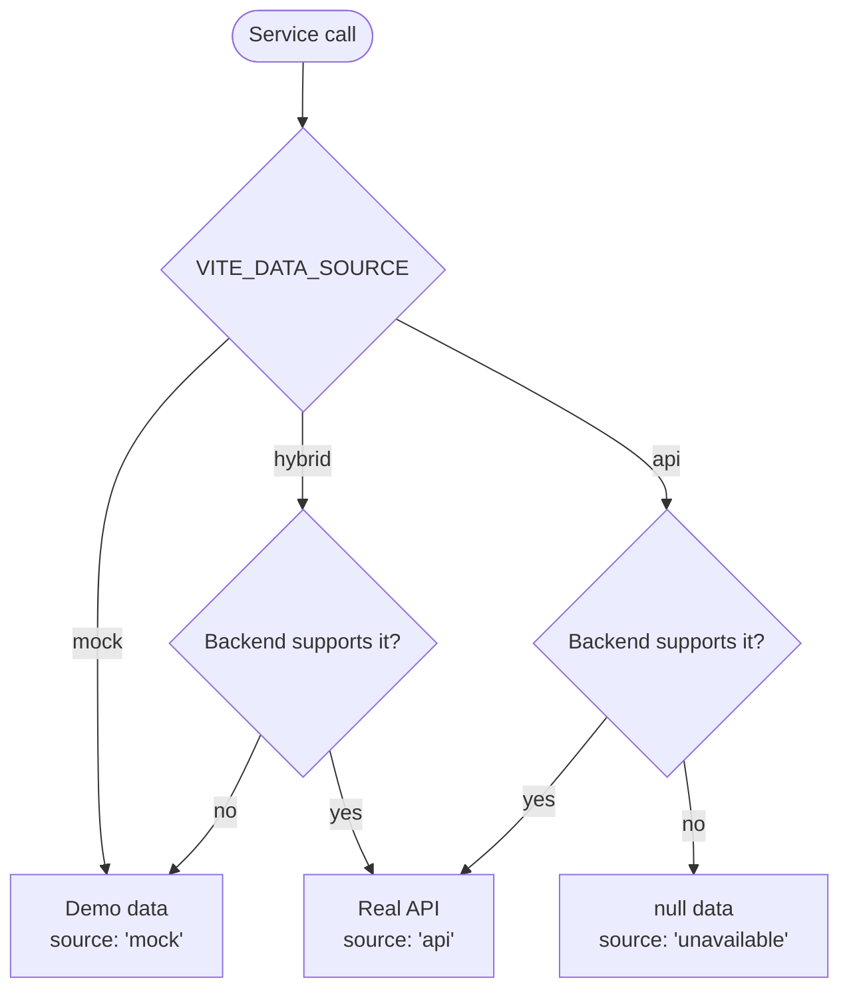

| Capability | `mock` | `hybrid` | `api` |
|---|---|---|---|
| System status, events, registered herd, safe zones | demo | **API** | **API** |
| **Authentication** | demo | **API** | **API** |
| Cameras, detections, detected count, farm | demo | demo | unavailable |

Authentication is the row that does not follow the pattern, and deliberately
so. Every other capability falls back to demo data in `hybrid`; sign-in does
not, because a session that is not real cannot protect anything and is
indistinguishable from one that is. It used to fall back, which meant the
deployed app -- running in `hybrid` -- authenticated against unsalted SHA-256
hashes in `localStorage`.

Rules:

- All fictional data lives in `src/mocks/` and starts with a `DEVELOPMENT MOCK DATA` header.
- Every service returns `{ data, source }`. When anything on screen comes from demo data, the UI shows a **"Datos de demostración"** badge.
- In `mock` mode the backend is never contacted, so the server pill reads **"Servidor: modo demostración"**, never "en línea". Only a real `/health` reply with `status: "ok"` shows the server online.
- A failed backend call is never replaced with demo data. Screens show the cause (no connection, timeout, HTTP 401/404/422/5xx or an unexpected response). If a background refresh fails, the last data stays on screen with a warning.
- Backend responses are validated in `src/api/validate.ts`. Events with an `event_type` the frontend does not know are skipped with a console warning, so one new type does not hide the rest.
- An empty `/api/animals` list is a normal state ("No hay animales registrados"), not an error. The empty state says what registering the herd buys, because counting what a camera sees cannot tell you which animal is missing.
- A write that needs the owner role is not offered to a worker. The backend
  answers 403 either way; hiding the control prevents a mistake rather than an
  attacker.
- Demo detections are deterministic (seeded per camera) so screenshots and tests are stable.
- Event kinds that the backend does not emit yet (`person_detected`, `possible_intrusion`, ...) exist only in demo data.

### Event language

`src/lib/eventCatalog.ts` maps each event kind to a Spanish label, a category and a default severity. Object detection cannot know intent, so the UI never says "thief" or "robbery":

| Kind | Label (UI) | Category | Default severity |
|---|---|---|---|
| `cattle_out_of_zone` | Animal fuera de la zona segura | cattle | warning |
| `person_detected` | Persona detectada | security | info |
| `possible_intrusion` | Posible intrusión | security | critical |
| `external_animal_detected` | Animal externo detectado | cattle | warning |
| `possible_unauthorized_movement` | Posible movimiento no autorizado de ganado | security | critical |
| `camera_disconnected` | Cámara desconectada | system | warning |
| `ai_unavailable` | Servicio de visión no disponible | system | critical |

Severity from the catalog is a presentation default (`severitySource: 'catalog'`). When the backend sends severity (for example, a night-time rule), it takes precedence (`severitySource: 'backend'`).

---

## Authentication

Sign-in goes to the backend. The demo service is still there, behind the same
`AuthService` interface, and it is used **only** when `VITE_DATA_SOURCE=mock`.

That distinction matters: `hybrid` used to fall back to the demo service, so
the deployed app -- which runs in hybrid -- authenticated against unsalted
SHA-256 hashes in `localStorage`. Authentication is the one capability where
falling back to a demo is worse than failing, because a session that is not
real cannot protect anything and looks exactly like one that is.

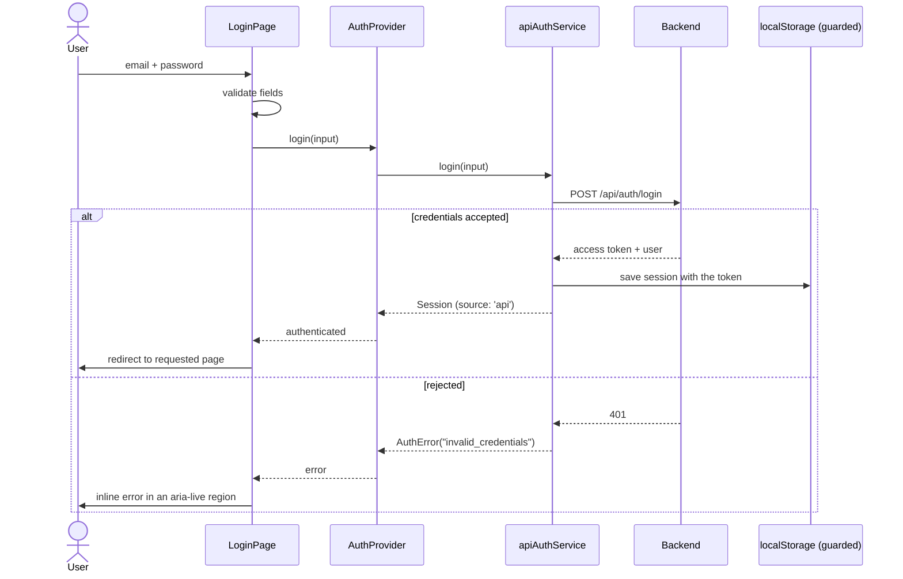

### What the backend decides

- **One message for every failure.** A wrong password, an unknown address and
  a deactivated account all return the same 401. Distinguishing them would
  turn the form into a way to find out which addresses have accounts, so the
  interface shows one message because there is no detail to show.
- **The first account registered is the owner**, and every later one is a
  worker. The client cannot ask for a role; it reads the one that comes back.
- **Passwords are limited to 72 bytes**, which is bcrypt's limit. Accented
  letters are two bytes in UTF-8, so the message says bytes rather than
  letters -- a password well under 72 characters can still exceed it.
- **A session lasts an hour** (`ACCESS_TOKEN_MINUTES` on the backend). There
  is no refresh token, so expiry ends the session and `AuthProvider` signs the
  user out on a timer rather than letting every request start failing with a
  401.

### Restoring a session

`getSession()` confirms the stored token against `GET /api/auth/me` instead of
trusting it. A well-formed token stops working when the account is deactivated
or the deployment's signing secret is replaced, and both leave something that
looks perfectly valid in storage.

Only a 401 clears the session. A network failure or a server error keeps it,
because a dropped connection is not a signed-out user -- and on a rural link
that is the normal case rather than the exceptional one.

### Demo accounts

Only in `mock` mode. Password `demo1234`: `carmen.rojas` /
`dueno@sanjose.demo` (owner) and `julian.perez` / `trabajador@sanjose.demo`
(worker). Sign in with the username or the email; the "Cuentas de
demostración" disclosure fills them in.

A demo session carries **no token**, which is what makes it unusable against
the backend rather than quietly half-working. The profile page labels it, so a
write that cannot reach a server is not a mystery.

| Sign up |
|---|
| 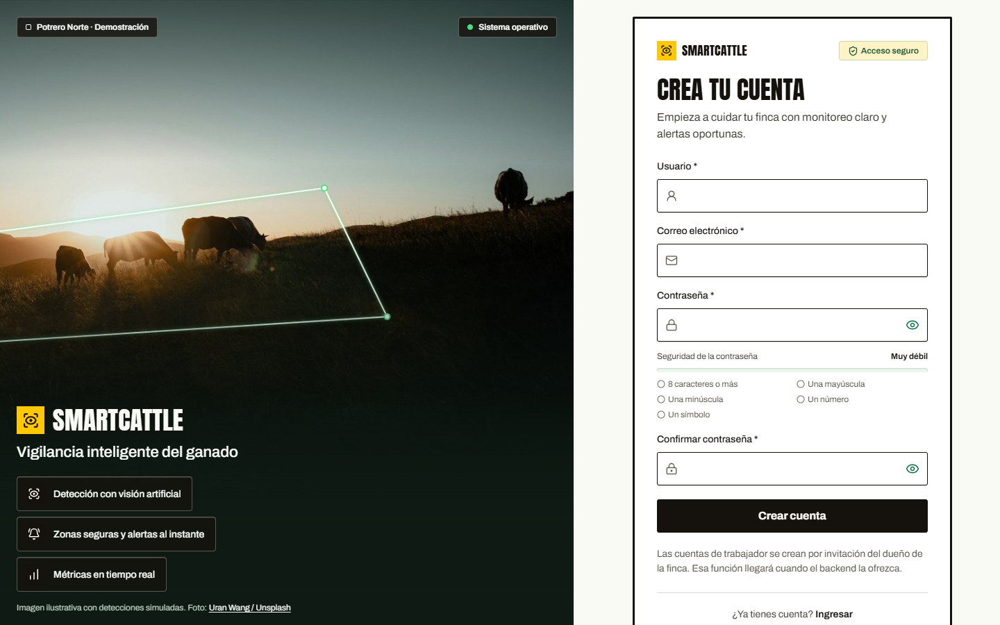 |

- Registration asks for email, password and confirmation, with a live password
  strength meter and a caps-lock warning.
- After repeated failed attempts the backend refuses the address for a while
  and the form shows the countdown. The lockout is keyed on the address rather
  than the connection, because the farm staff share one.
- "Recordarme" and "¿Olvidaste tu contraseña?" are still visual only: the
  session already persists, and password recovery needs an email sender the
  backend does not have.

### Roles

`users.role` is `owner` or `worker`. The backend enforces it on every write;
`src/lib/permissions.ts` shapes the interface so a worker is not offered a
control whose every use returns 403. **The guard in the browser is a courtesy,
not a control.**

| Permission | Owner | Worker |
|---|---|---|
| `monitoring:view`, `events:view`, `events:review` | yes | yes |
| `herd:edit`, `zones:edit` | yes | no |
| `farm:edit`, `workers:manage`, `cameras:configure`, `alerts:configure`, `security-hours:configure` | yes | no |

`RequireAuth` accepts an optional `role`, and a worker reaching an owner route
is redirected to the dashboard rather than shown an error: they are signed in
and simply cannot be there.

### What is still missing

- No password recovery, and no email sender to build it on.
- No invitation flow, so a worker account is created by registering and then
  changing `users.role` in the database.
- No way to sign out other devices. The backend has no revocation list, so a
  token works until it expires; replacing `JWT_SECRET` signs everyone out.

---

## Routing and navigation

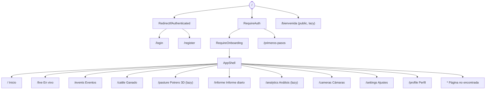

- Anonymous visitors to `/` land on the public page, `/bienvenida`. Any other private route redirects to `/login` and comes back to the requested page after signing in.
- Someone who has not had the first-run conversation goes to `/primeros-pasos` once. After that, signing in opens the page they chose as their start.
- The navigation is defined once in `src/app/navigation.ts`.
- **Desktop (≥ 1024 px):** black side rail with the nine sections, the active one printed in that page's ink, the demo badge and the signed-in user.
- **Mobile:** black top bar, a five-cell tab bar (Inicio, En vivo, Eventos, Informe, Más) and a native `<dialog>` sheet for Ganado, Potrero 3D, Análisis, Cámaras, Ajustes and Perfil.
- **Alarm banner:** when the live map or the 3D pasture raises a zone alarm, a solid red band prints across the page with a "Silenciar" action.
- "Security" is a tab inside Events rather than a separate page: security alerts are events, and a separate page would duplicate the list and filters.

---

## Dashboard

The dashboard answers "is everything OK on the farm right now?" first, then where and what happened.

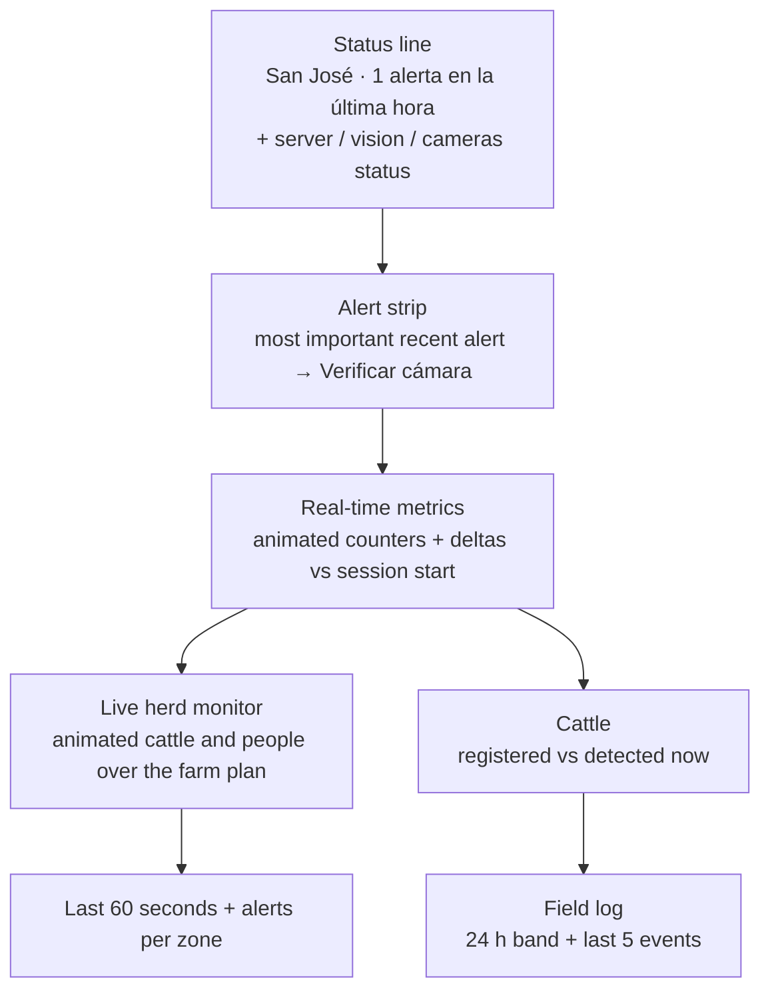

| Block | Source today | Notes |
|---|---|---|
| Server status | `GET /health`, `GET /api/status` | "Visión configurada" only means an AI URL is set |
| Events, alert strip, field log | `GET /api/events` (demo in `mock` mode) | Polled every 15 s |
| Registered cattle | `GET /api/animals` | Shows "Sin registros" while the backend list is empty |
| Detected now, cameras, farm plan, restricted hours | demo data | The plan is labeled "Esquema ilustrativo" |
| Real-time metrics, last 60 seconds chart, alerts per zone | live herd simulation | Cattle inside the perimeter, alerts issued, detections per minute and people detected, each with a ▲/▼ change since the session started |

Rules the dashboard follows:

- **"Active" alerts.** The backend has no review state, so the dashboard shows warning and critical events from the **last hour** and says so ("1 alerta en la última hora").
- **Never "all clear" without data.** If events fail to load or the server is offline, the headline reads **"Estado desconocido"**, not "Todo en orden".
- **Registered ≠ detected.** The two numbers are shown side by side with a note that occlusion, camera angle or lighting can lower the detected count.
- **Stale data stays visible.** A failed background refresh keeps the last data and shows the offline notice. Retries are automatic.
- **Time to scale.** The 24 h band places each event at its real time and shades the restricted hours.

### Live herd monitor

"Monitoreo en vivo" animates a seeded demo herd over the farm plan. Each cow is a top-down Holstein marker with its tag number that turns toward where it walks, moves smoothly and lowers its head while grazing. People walk the track as yellow markers.

- When a cow crosses its lot boundary it turns red within 200 ms, gets a pulsing ring and the label "Fuera del perímetro", the lot is hatched red and the global alarm fires. Walking back in clears it.
- Controls: Pausar/Reanudar, speed ×1/×2 and "Simular salida", which forces one cow out to demo the alert.
- With `prefers-reduced-motion` markers move in steps and nothing pulses.

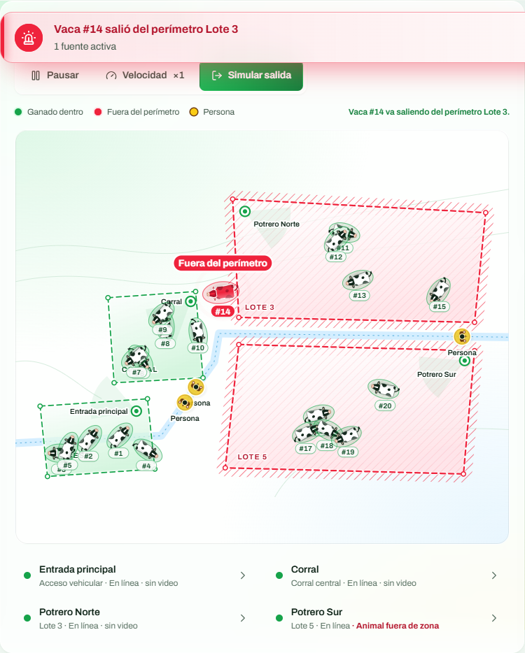

---

## Live monitoring

`/live?camera=<id>` shows one camera as the protagonist. Without a `camera` parameter it opens the camera with the most recent alert, so "Verificar cámara" on the dashboard lands on the evidence.

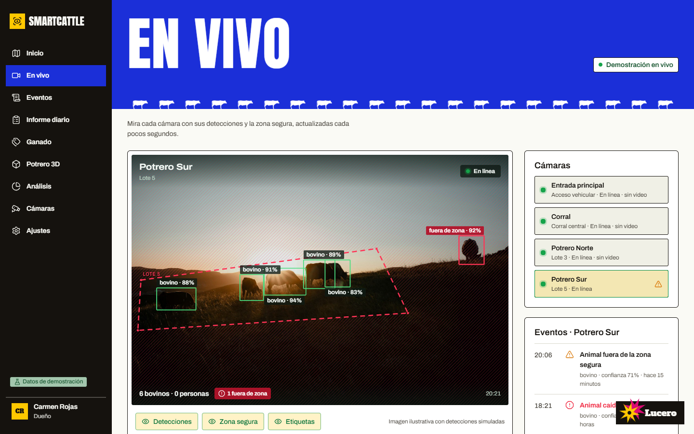

The camera stage stacks independent layers over the picture. Overlay coordinates are normalized (0–1) and drawn in the picture's own pixel space, so boxes stay registered to the image at any size.

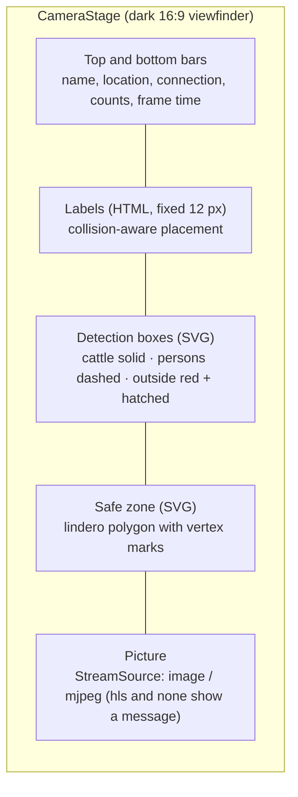

| Stage state | When | What the user sees |
|---|---|---|
| Loading / connecting | Camera or stream loading, or camera reports `connecting` | Spinner and text |
| Live | `image` or `mjpeg` source | Picture with overlays, counts, layer toggles |
| No stream | Source `none` (every camera except the demo one today) | "Sin transmisión disponible" |
| Unsupported | Source `hls` (no player bundled yet) | "Formato de video no compatible" |
| Offline / error | Camera status | Message, plus last signal time when offline |
| Vision not configured | `ai_service.configured = false` | Warning notice; counts say there are no detections |
| Server offline | `/health` fails | Critical notice; data refresh retries automatically |

- **Demo picture.** No camera streams exist yet. The south pasture camera shows the illustrative dusk photo with hand-placed detections (one animal outside the zone), labeled "Imagen ilustrativa con detecciones simuladas".
- **Polygon zones.** A safe zone may carry an `outline` polygon; zone membership then uses the polygon (bottom-center of each box, the same anchor as the prototype rule) instead of the bounding box.
- **Layer toggles** (Detecciones, Zona segura, Etiquetas) only change the display. They never touch backend data.
- **Polling:** detections every 5 s, cameras, events and status every 15 s. Changing camera never shows the previous camera's data.
- **Mobile:** the camera strip scrolls horizontally and keeps the selected camera in view; persons and outside-zone labels stay, other labels hide on narrow screens to avoid clutter.

---

## 3D pasture

`/pasture` ("Potrero 3D") shows the farm as an interactive 3D scene. The user orbits, pans and zooms around the farm, sees the herd grazing inside the fenced lots, workers walking the farm track and the cameras on their poles. When a cow leaves its lot, that lot's fence and ground turn red, a label appears over the animal and the exit is announced and logged.

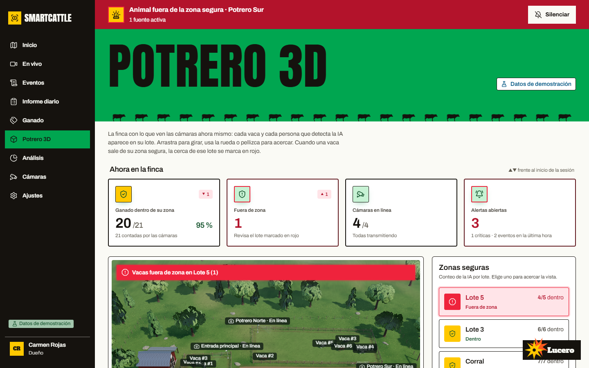

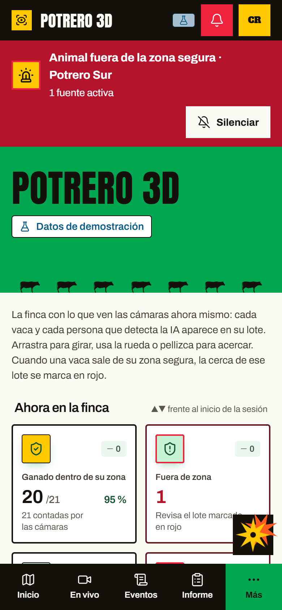

The page is a **demo simulation**, labeled as such on screen. The backend has no animal positions yet, so the herd moves with a seeded simulation over the same farm plan the dashboard uses (`src/mocks/mockFarmPlan.ts`). When real detections with positions exist, the simulation can be replaced by that data without touching the scene.

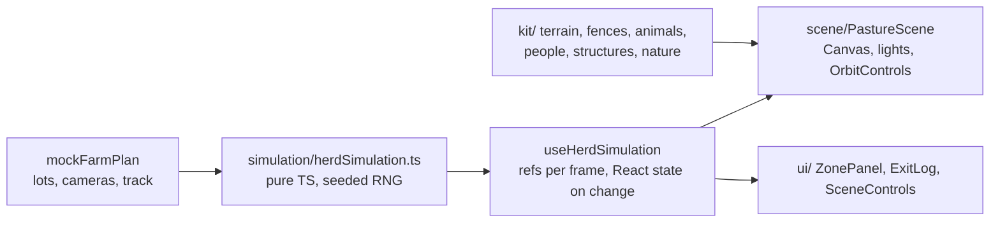

- **Modular asset kit.** Assets live in family folders, like a modular asset library: `kit/terrain`, `kit/environment`, `kit/fences`, `kit/animals`, `kit/people`, `kit/structures`, `kit/nature`. Cows use a CC0 glTF model (`public/models/cow.glb`) with coats (Holstein, criollo, black Brangus, zebu) generated at runtime; people, fences, barn, trees, rocks, grass, terrain and sky are procedural. Geometries and materials are shared.
- **Zone state.** Each lot is a safe zone. Membership is a point-in-polygon test on the lot boundary. A breached zone shows red, a pulsing outline, a label with the cow's name and the words "fuera de zona", so the state is never color-only.
- **Controls.** Pause/resume, "Provocar salida" (forces one cow out to demo the alert), name labels on/off and camera presets (overview and one per lot). The zone panel lists cows inside each lot; the exit log keeps the session's exits and returns.
- **Performance.** Positions update in refs inside the render loop; React state changes only when a zone's status changes. Device pixel ratio is capped at 2.
- **Fallbacks.** Without WebGL the page explains it instead of showing an empty canvas. With `prefers-reduced-motion` the simulation starts paused and camera presets jump instead of flying.

---

## Daily report

`/informe` ("Informe diario") reads the day's report from `GET /api/reports/daily`, the same one the dashboard summarises. Nobody has to generate or send it.

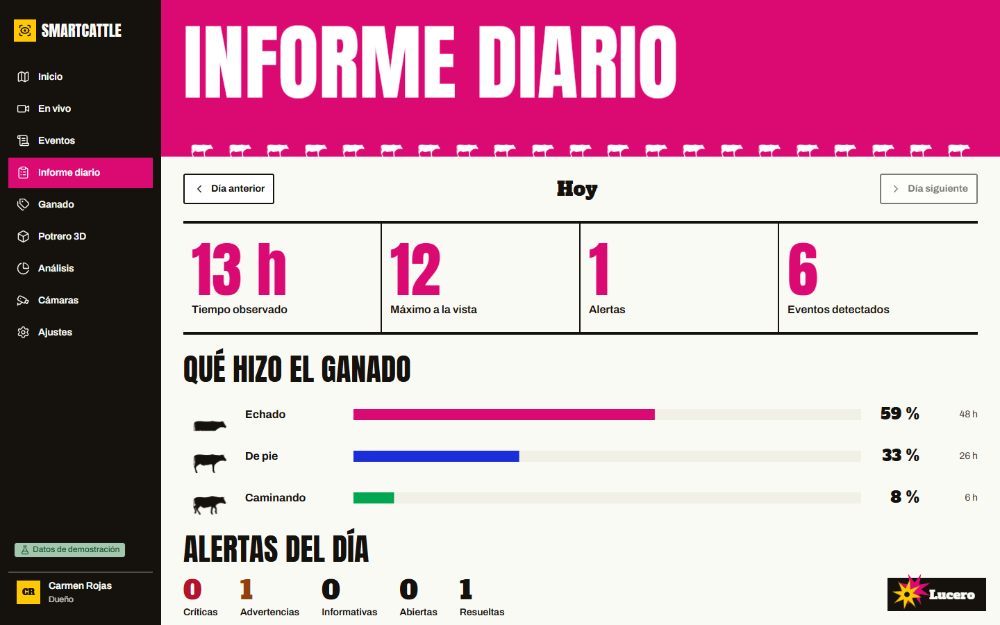

- Four big figures: time observed, peak animals in view, alerts and detected events.
- "Qué hizo el ganado": lying, standing and walking as bars that add up to 100 %, each with its share and hours.
- Alerts of the day by severity, open and resolved, and notices such as a herd that barely lay down.
- Previous and next day. Without activity the page says so; it never invents a figure. It is not a veterinary diagnosis, and the page says that too.

---

## First run and the assistant

**First run.** After the first sign-in, Lucero asks what the person wants to watch (cattle leaving, people, animals lying down, the daily report) and where they want to start. The answers order the dashboard's "Lo que elegiste vigilar" strip and the assistant's suggestions. They are stored in this browser per user (`smartcattle.onboarding.<userId>`), because the backend has no endpoint for preferences yet.

**Lucero.** The star in the corner of every signed-in page. Each question goes to `POST /api/assistant/messages`, where the backend answers with Claude from the signed-in account's counts. No email or camera address leaves the server, and the browser never sees an API key.

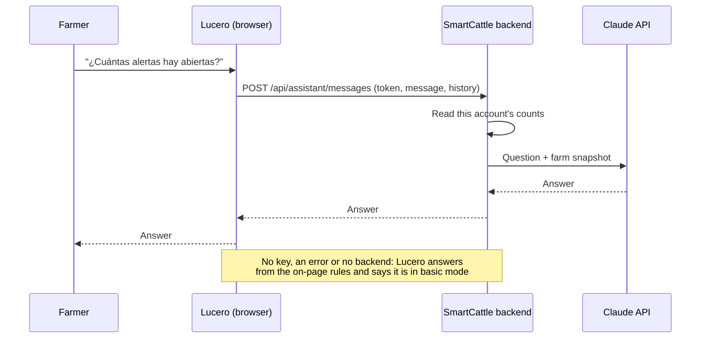

Without `ANTHROPIC_API_KEY` the endpoint returns 503, and Lucero falls back to the rule-based answers, saying so. The model never writes SQL and has no tools.

## Analytics

`/analytics` ("Análisis") turns the event history into percentages and trends for the last 24 hours, 7 days or 30 days.

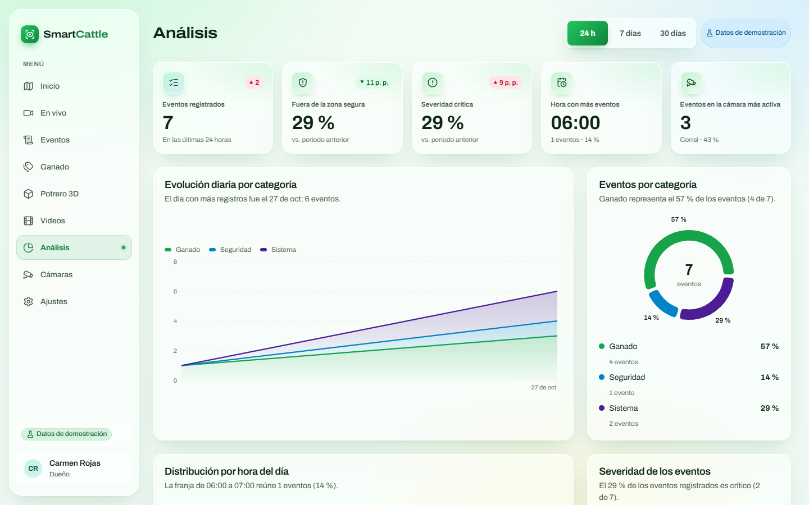

| Chart | Question it answers |
|---|---|
| KPI row | How many events, what share were cattle outside the zone, what share were critical, busiest hour and camera |
| Daily trend | How events evolve per day, stacked by category |
| Category donut | Cattle vs. security vs. system, in percent |
| Hour of day | When events happen |
| Severity bar | Share of info, warning and critical |
| Events per camera | Which camera reports the most |
| Detector confidence | Distribution of the confidence the detector reported per event |

- Percentages use largest-remainder rounding, so each chart adds up to exactly 100 %.
- Every chart has a one-line insight computed from the data and a visually hidden data table for screen readers.
- Confidence is labeled as the detector's per-event value, not model accuracy. A lower count is not presented as lost animals.
- Data comes from `GET /api/events` (demo events in `mock` mode, marked with the demo badge).
- A range selector moves between 24 h, 7 días and 30 días. KPI tiles count up and show their change.

---

## Motion

Motion is about the cattle, and it follows what the cameras report. Presets live in `src/motion/presets.ts` and mirror the CSS tokens.

| Where | What moves |
|---|---|
| Public page | Scroll flies through a letter of the headline into the pasture, then a walk, a cow lying down and a cow leaving the zone. The fence turns red and the page's frame prints in red |
| Page bands | One printed figure per animal in view, in the posture the AI reports: walking figures walk, lying figures lie |
| 3D pasture | Each cow takes the reported posture. A lying cow far from its target moves there before walking on, so it never slides while lying |
| Side rail and mobile tab bar | The active marker slides between items |
| Lucero | The star idles, turns while thinking and pulses while speaking |
| Login and register | The photo's detection boxes appear one by one over the real dusk photo |
| Analytics | Range tabs slide their indicator; KPIs count up; bars grow in |
| Buttons | Press feedback under 160 ms; hover effects only on devices that really hover |

Animation uses `transform`, `opacity` and `clip-path`. With `prefers-reduced-motion` the public page is a still farm with the headline over it, the printed figures stop and the scroll story is replaced by the sections below it.

## Design system

The visual direction is **"Cartel de feria"**, a cattle fair poster: flat inks, huge condensed type, thick rules, no glass and no gradients. Every page prints in one ink, chosen in `src/app/navigation.ts`. The camera stage stays dark and the 3D pasture keeps its realistic look.

| Ink | Token | Value | Used by |
|---|---|---|---|
| Verde | `--ink-verde` | `#00A650` | Inicio, Potrero 3D |
| Maíz | `--ink-maiz` | `#FFC800` | Ganado, Cámaras, main actions |
| Fucsia | `--ink-fucsia` | `#DB0A73` | Informe diario, Lucero |
| Cobalto | `--ink-cobalto` | `#1B2FD8` | En vivo, Análisis |
| Naranja | `--ink-naranja` | `#FF5A1F` | Eventos |
| Tinta | `--ink-tinta` | `#15120E` | Ajustes, Perfil, shell, text |
| Papel | `--ink-papel` | `#FAFAF5` | Ground |

- **Typography:** Anton for headlines, Alfa Slab One for figures and stamps, Archivo for reading.
- **Routes:** `data-ink` on the shell sets `--route-ink` and `--route-on-ink`, and components read those.
- **States** always combine an icon and a word, never color alone. Outside-zone areas are also hatched.
- **Honesty:** what is simulated says so. The public page is labeled "Simulación ilustrativa" and demo data carries the demo badge.
- Older `--glass-*` and `--gradient-*` tokens map to flat values, so a component that still names them prints flat.
- Text selection, focus rings, the caret and scrollbars are themed from the palette.

## Accessibility

- Semantic landmarks, a "Saltar al contenido" skip link and one `h1` per page
- Visible focus ring on every interactive element
- Labels linked to inputs, `aria-invalid` and `aria-describedby` for errors and hints, focus moved to the first invalid field
- Touch targets of at least 44 px, 16 px inputs (no zoom on iOS), safe-area insets
- Status never conveyed by color alone
- `prefers-reduced-motion` disables decorative motion

## Testing and quality checks

```sh
npm test        # 251 tests in 26 files
npm run lint
npm run build
```

Covered: configuration parsing, the HTTP client (success, HTTP error, network, timeout, invalid JSON), mappers, data-source resolution, every service in `api` and `mock` mode, the demo auth service, permissions, safe storage, form validation, date and number formatting, the dashboard rules (recent alerts, unknown state, 24 h band positions and restricted hours across midnight), the live herd simulation and its metrics, the 3D herd simulation, the video analysis model, analytics percentages and the motion primitives.

Each change is also reviewed with desktop (1440 px) and mobile (390 px) screenshots and an automated design detector before it is committed.

---

## Implemented features

**Phase 1: Foundation**
- Vite + React + strict TypeScript project, ESLint, Vitest, `@/` alias
- Typed API client, data services, source resolution and centralized demo data
- Design tokens, self-hosted variable font, base styles and reduced-motion rules
- Responsive app shell: side rail (desktop), tab bar and sheet (mobile), route transitions
- Base components: Button, TextField (with password reveal), StatusPill, Notice, EmptyState, ErrorState, Skeleton
- Favicon (a *lindero* mark) and mobile meta tags

**Phase 2: Authentication**
- Login and registration on a real dusk pasture photo with a safe-zone overlay and simulated detections, including one outside the zone
- Field validation, error and loading states, demo-account shortcuts
- Demo auth service with owner and worker roles, session persistence, route guards
- Signed-in user in the rail and logout from the profile page

**Phase 3: Dashboard**
- Status line with the farm name and condition, plus server, vision and camera status
- Recent-alert strip with a direct link to verify the camera
- Schematic farm plan: lots drawn as linderos, cameras as observation points with view wedges, the alert lot hatched, a pulse on the alert camera and a camera list
- Registered vs. detected cattle with the occlusion note
- Field log over a true-scale 24 h band with restricted hours
- Loading, empty, error, offline and unknown states

**Phase 4: Live monitoring**
- Camera stage with picture, lindero safe zone and detection boxes registered to the image
- Distinct strokes for cattle, persons and outside-zone detections; collision-aware labels
- Layer toggles, detection counts and an outside-zone chip
- Camera switcher (side list on desktop, scrollable strip on mobile), per-camera events and service status
- Designed states: loading, connecting, live, no stream, unsupported format, offline, error, vision not configured, server offline

**Phase 5: Cameras**
- One card per camera (cameras are real objects, so they get cards): picture or a short placeholder, status, zone, last connection, detection counts, "Ver en vivo"
- Cameras with recent alerts first, then cameras with connection problems
- Owners see a note that adding or rezoning cameras needs backend support; no fake configuration controls

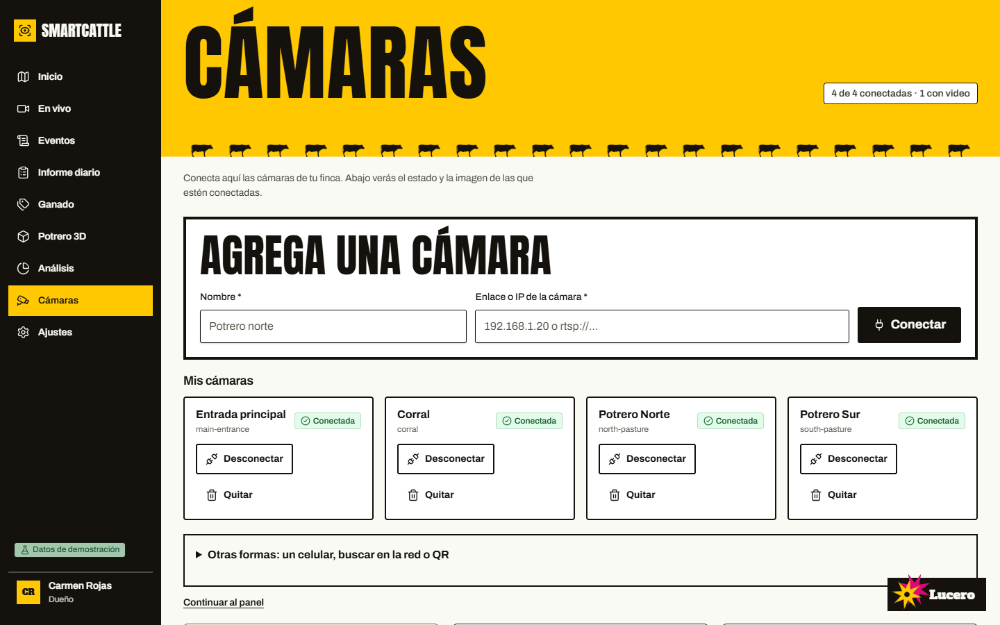

**Phase 6: Cattle**
- Herd figures: registered vs. detected now, with the occlusion note
- Cattle visible per camera and outside-zone counts, labeled as a per-camera view (cameras cover only part of the farm, so rows are not a herd total)
- Recent cattle movements (outside-zone exits, external animals)
- No veterinary data: no vaccines, treatments, weights or collars

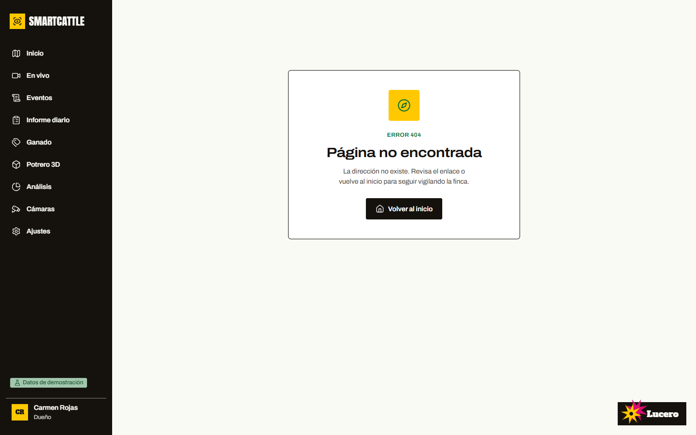

**Phases 7 and 8: Events, alerts and security**
- Category tabs with counts: Todos, Seguridad, Ganado, Sistema (security is a tab, not a separate page, because security alerts are events)
- Client-side filters for period, camera and minimum severity (the backend returns the latest 1000 events without query options), with a clear-filters action and an empty state for no matches
- History grouped by day ("Hoy", "Ayer", full date); relative times count calendar days so they agree with the groups
- Event detail answering what, when, where, which camera, how severe and what evidence exists. Severity says whether the server assigned it or the app estimated it; evidence says plainly that the server does not store images yet
- Security tab: "Una detección de persona no indica intención", restricted hours shown, and security events during restricted hours marked "Horario restringido"
- Labels follow the event catalog: "Persona detectada", "Posible intrusión", "Posible movimiento no autorizado de ganado". Never "thief" or "robbery"
- Detail is a sticky side panel on desktop and a native `<dialog>` bottom sheet on phones; the selected event lives in the URL (`?event=<id>`)

| Security tab with detail | All events |
|---|---|
| 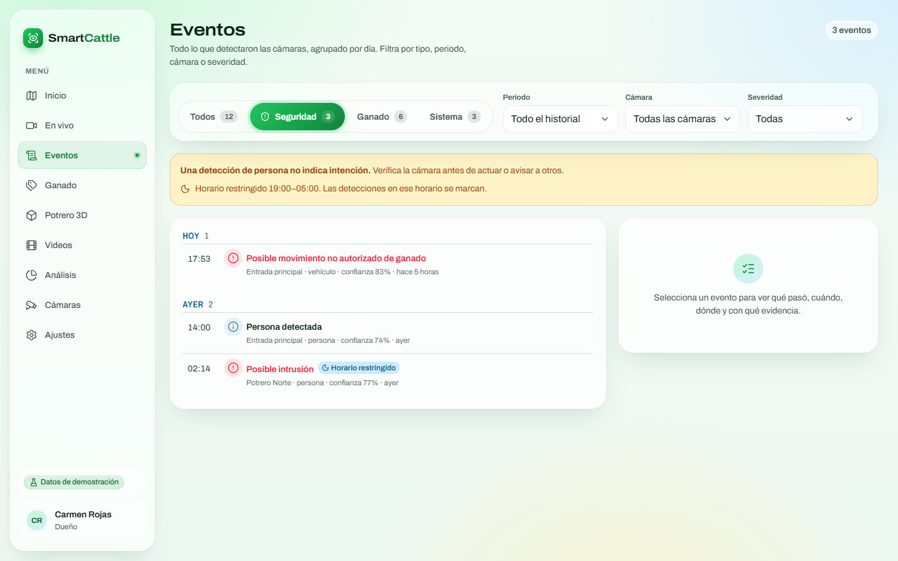 | 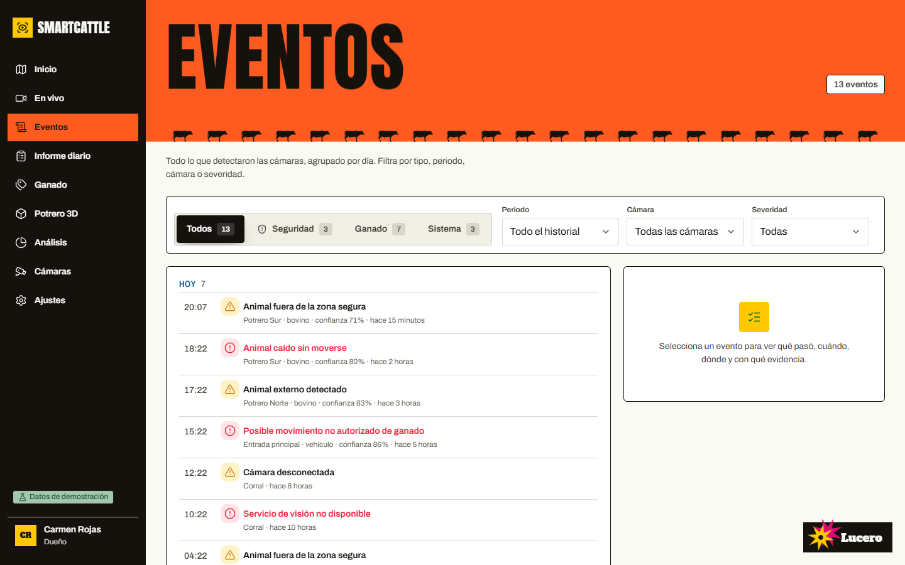 |

**Phase 9: Settings**
- Account section for every user; farm, users, cameras and safe zones, security hours and alert classification for owners only (permissions from `src/lib/permissions.ts`)
- Everything is read-only and each section says why: the backend has no endpoints to change settings, invite workers, change passwords or send notifications yet
- Workers see their account and a note that the owner manages the rest

| Settings | Profile |
|---|---|
| 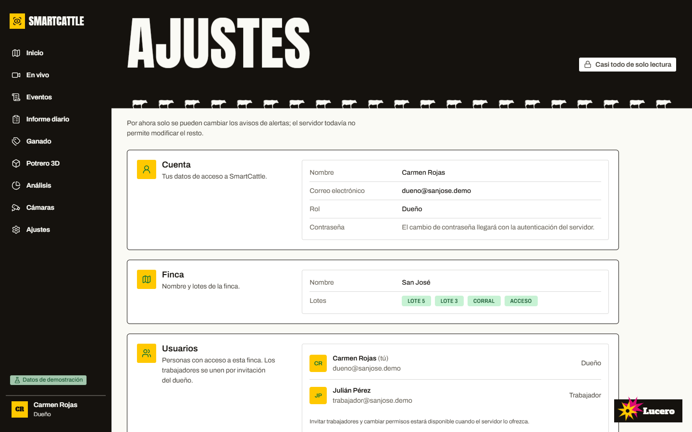 | 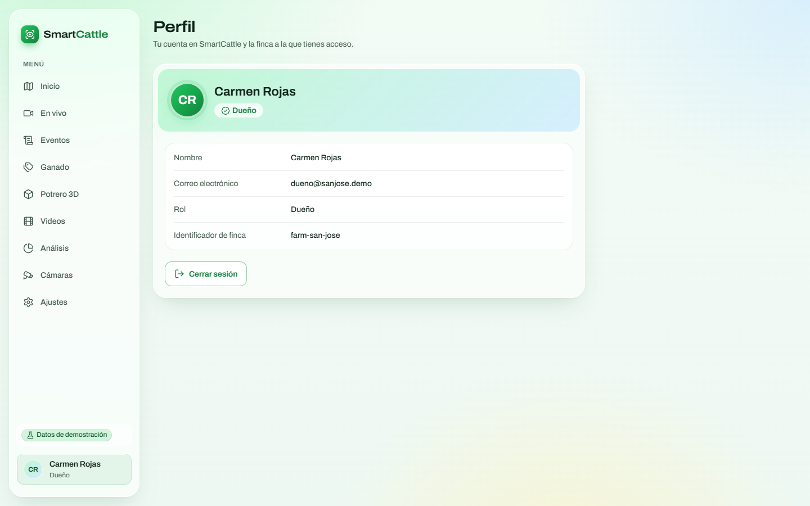 |

**3D pasture, analytics and motion**
- Interactive 3D pasture with a procedural asset kit, a seeded herd simulation and zones that turn red when a cow leaves them
- Analytics page with percentage charts, KPIs and accessible data tables
- App-wide motion: route transitions, sliding navigation marker, staggered lists, count-up figures, masked headlines

**Cartel de feria redesign**
- Public page at `/bienvenida`: a scroll story through the approved pasture, labeled as a simulation, with a still version for reduced motion
- Flat poster inks, one per page; herd band printed from the live detections
- Camera form reduced to Name and Link; the phone, network search and QR options are one fold away; video upload removed: cameras are live only
- The 3D pasture shows the postures the AI reports and names them in a legend, with no contradictions
- Daily report page, first-run conversation and the Lucero assistant

## Roadmap

| Phase | Scope | Status |
|---|---|---|
| 1 | Foundation | Done |
| 2 | Authentication | Done |
| 3 | Dashboard: farm status line, farm plan with cameras and safe zones, registered vs. detected cattle, field log with 24 h band | Done |
| 4 | Live monitoring: camera stage, detection and safe-zone overlays, status panels, all connection states | Done |
| 5 | Cameras: list, states, live access | Done |
| 6 | Cattle: registered vs. detected, recent detections, zone states | Done |
| 7 | Events & alerts: history, filters, detail with evidence | Done |
| 8 | Security: person detection, possible intrusion, restricted hours | Done |
| 9 | Settings: farm, users, cameras, alerts, account (permission-aware) | Done |
| — | 3D pasture, analytics, motion | Done |
| — | Dashboard V15: live herd monitor, realistic 3D pasture | Done, later replaced visually |
| — | Cartel de feria: public page, daily report, first run, assistant, live-only cameras | Done |
| 10 | Quality: accessibility and responsive audit | Next |

Pending on the backend side: authentication, cameras, streaming, detections, safe zones, severity and notifications. The frontend is ready to switch each capability from demo data to the API as it lands.

## Credits

- Login photo: [Cows grazing in a field at sunset](https://unsplash.com/photos/cows-grazing-in-a-field-at-sunset-HaSohIaDVdI) by Uran Wang, [Unsplash License](https://unsplash.com/license). Used as an illustrative image, not farm footage. The detections drawn over it are simulated.
- Icons: [Lucide](https://lucide.dev) (ISC License).
- 3D: [three.js](https://threejs.org) and [React Three Fiber](https://docs.pmnd.rs/react-three-fiber) (MIT License). Cow model: "Cow" from the [Ultimate Animated Animal Pack](https://quaternius.com/packs/ultimateanimatedanimals.html) by Quaternius (CC0 1.0); see `public/models/CREDITS.md`. All other 3D assets are procedural and original to this project.
- Charts: [Recharts](https://recharts.org) (MIT License). Motion: [Motion](https://motion.dev) (MIT License).
- Fonts: [Archivo](https://fonts.google.com/specimen/Archivo) by Omnibus-Type, [Anton](https://fonts.google.com/specimen/Anton) by Vernon Adams and [Alfa Slab One](https://fonts.google.com/specimen/Alfa+Slab+One) by JM Solé (SIL Open Font License).
- Printed cattle figures: rendered from the Quaternius cow model above with `scripts/render-herd-sprites.mjs`.
